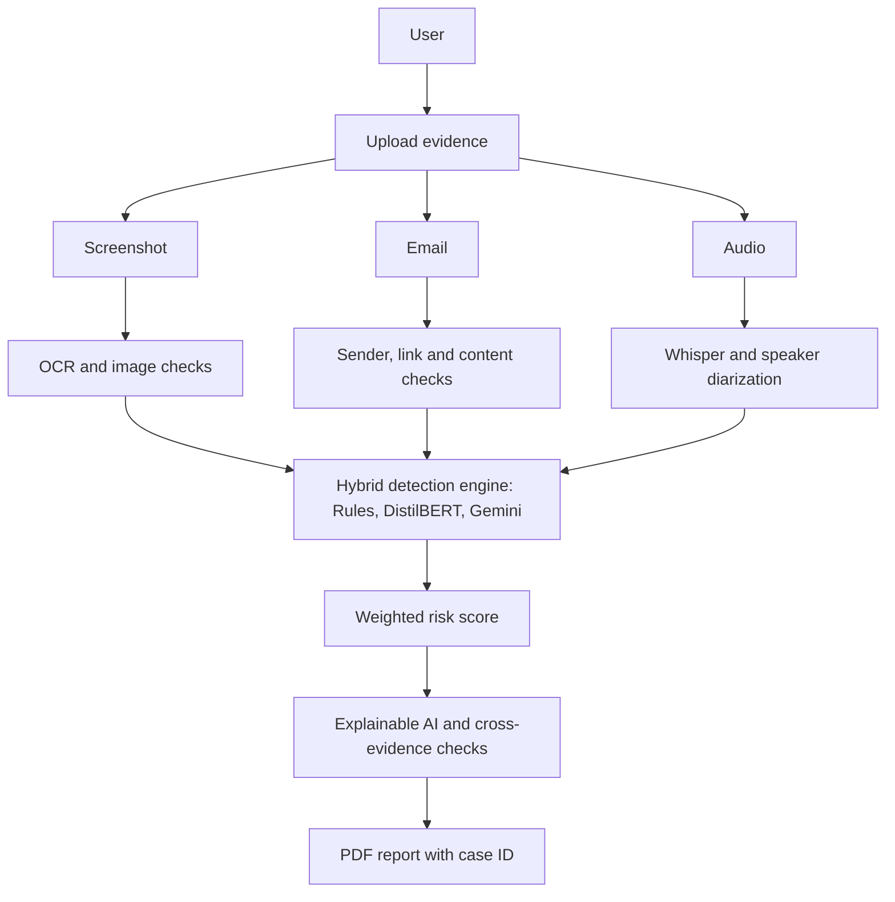

# DEEP SHIELD

**A multimodal AI system that analyses scam evidence (screenshots, emails and call recordings), explains its verdict, and generates a PDF report for cybercrime complaints.**


---

## Table of Contents

- [Problem](#problem)
- [Features](#features)
- [How Detection Works](#how-detection-works)
- [System Architecture](#system-architecture)
- [Tech Stack](#tech-stack)
- [Project Structure](#project-structure)
- [Getting Started](#getting-started)
- [Training the Scam Classifier](#training-the-scam-classifier)
- [API Endpoints](#api-endpoints)
- [Troubleshooting](#troubleshooting)
- [Limitations](#limitations)
- [Future Work](#future-work)
- [Team](#team)
- [Acknowledgements](#acknowledgements)

---

## Problem

Online scams are growing through fake payment screenshots, phishing emails, fraudulent messages and AI-generated voice calls. Most existing tools:

- analyse only one type of evidence at a time,
- return a risk score without explaining why,
- leave victims struggling to collect evidence for cybercrime reporting.

DEEP SHIELD analyses all of these evidence types in one platform, explains every decision, and produces a complaint-ready report.

## Features

- **Screenshot Analyzer**: OCR text extraction, fake-payment and refund-scam pattern detection, QR code decoding, image-structure checks, and AI visual inspection of the image itself.
- **Email Analyzer**: sender and display-name checks, link inspection (raw IPs, lookalike domains, risky domain endings), urgency and phishing-language detection.
- **Audio Analyzer**: speech-to-text with timestamps, speaker diarization (Speaker 1, Speaker 2, ...), OTP and money-request detection, pressure-tactic detection, callback numbers and repeated robocall scripts.
- **Hybrid detection engine**: rules, a fine-tuned DistilBERT model, and Google Gemini reasoning combined into one transparent score.
- **Explainable results**: risk level, confidence, plain-English reasons (labelled by source) and recommended actions.
- **Cross-evidence analysis**: timestamps and amounts are compared across screenshot, email and call to flag contradictions.
- **PDF reports**: case ID, timestamp, verdict, evidence breakdown, transcript, extracted text and the attached screenshot. Available from every analyzer and the combined analysis.
- **User accounts**: registration and login with hashed passwords and JWT sessions.

## How Detection Works

Each analysis passes through up to three layers, and the final score is a weighted blend.

| Layer | What it does | Used for |
|---|---|---|
| 1. Rules | Keyword, pattern and structural checks (fast, free, transparent) | Screenshot, Email, Audio |
| 2. Fine-tuned DistilBERT | Scores the language of the text as scam or legitimate | Email, Audio transcript |
| 3. Google Gemini | Reasons about the content; for screenshots it inspects the real image | Screenshot (when a payment is claimed), Email and Audio (when the score is borderline, 25 to 70) |

**Risk levels:** Low (below 40), Medium (40 to 69), High (70 and above).

**Blending rules**

- Email and Audio: `0.45 x rule score + 0.55 x model score`.
- Gemini's weight depends on its own stated confidence: High 0.75, Medium 0.6, Low 0.5. A high-confidence verdict of 70 or more cannot be pulled below 70.
- Screenshots that ask for a refund of money "sent by mistake" are floored at 75, because a screenshot can never prove that money actually moved.
- Amount mismatches across evidence within 48 hours raise the combined score.
- If Gemini is unavailable or times out (30 s limit, retried on 503 errors), the system falls back to the remaining layers instead of failing.

## System Architecture



## Tech Stack

| Area | Technologies |
|---|---|
| Frontend | React (Vite), Tailwind CSS, React Router, Axios |
| Backend | Python 3.11, Flask, Flask-CORS, PyJWT, bcrypt, python-dotenv |
| Database | MongoDB, PyMongo |
| Screenshot analysis | Tesseract OCR (pytesseract), OpenCV, pyzbar, Pillow, NumPy |
| Email analysis | BeautifulSoup4, tldextract, validators |
| Audio analysis | OpenAI Whisper, pyannote.audio, FFmpeg, PyTorch |
| AI / ML | Hugging Face Transformers (DistilBERT), scikit-learn, Google Gemini API (`google-genai`) |
| Reports | ReportLab |

## Project Structure

```
deepshield/
├── backend/
│   ├── app.py                      # Flask entry point
│   ├── requirements.txt
│   ├── .env                        # secrets (not committed)
│   ├── models/
│   │   └── scam_classifier/        # trained DistilBERT (not committed)
│   ├── uploads/                    # uploaded files and reports (not committed)
│   └── modules/
│       ├── auth/                   # register, login, JWT
│       ├── screenshot_analyzer/    # OCR, QR, image checks, AI vision
│       ├── email_analyzer/         # sender, link and content analysis
│       ├── audio_analyzer/         # Whisper, diarization, scam detection
│       ├── explainable_ai/         # combined verdict, time-window checks
│       ├── report_generator/       # PDF reports and case storage
│       └── shared/                 # Gemini verifier, DistilBERT classifier
├── frontend/
│   └── src/
│       ├── pages/                  # Login, Dashboard, analyzers, Combined
│       └── components/             # Navbar, Layout, Card, RiskBadge, ReasonsList
├── .gitignore
└── README.md
```

## Getting Started

The steps below are for **Windows 10/11**.

### 1. Prerequisites

| Tool | Notes |
|---|---|
| [Python 3.11](https://www.python.org/downloads/) | Tick "Add python.exe to PATH" during install |
| [Node.js LTS](https://nodejs.org/) | Includes npm |
| [Git](https://git-scm.com/download/win) | |
| [MongoDB Community Server](https://www.mongodb.com/try/download/community) | Install as a service (Compass optional) |
| [Tesseract OCR](https://github.com/UB-Mannheim/tesseract/wiki) | Default path `C:\Program Files\Tesseract-OCR\tesseract.exe` |
| [FFmpeg **full-shared** build](https://www.gyan.dev/ffmpeg/builds/) | Add its `bin` folder to PATH, then reopen the terminal |

> The "essentials" FFmpeg build is not enough. Speaker diarization needs the shared DLLs from the **full-shared** build.

### 2. API keys and model access

1. **Gemini API key:** create one free at [Google AI Studio](https://aistudio.google.com/apikey).
2. **Hugging Face token:** create a Read token at [huggingface.co/settings/tokens](https://huggingface.co/settings/tokens).
3. While logged in to the same Hugging Face account, open these pages and click **Agree and access repository**:
   - `pyannote/speaker-diarization-3.1`
   - `pyannote/segmentation-3.0`
   - `pyannote/speaker-diarization-community-1`

### 3. Clone the repository

```bash
git clone https://github.com/YOUR-USERNAME/deepshield.git
cd deepshield
```

### 4. Backend setup

```bash
cd backend
python -m venv venv
venv\Scripts\activate
pip install -r requirements.txt
```

Create `backend/.env`:

```env
MONGO_URI=mongodb://localhost:27017/
DB_NAME=deepshield_db
JWT_SECRET=change-this-to-a-long-random-string
GEMINI_API_KEY=your-gemini-key
HF_TOKEN=your-huggingface-token
```

Add the trained classifier to `backend/models/scam_classifier/` (see [Training the Scam Classifier](#training-the-scam-classifier)). The app still runs without it, but the DistilBERT layer is skipped.

Start the backend:

```bash
python app.py
```

The first start is slow because Whisper and the diarization model load. Wait for these lines:

```
Scam classifier loaded.
Whisper model loaded.
Speaker diarization model loaded.
```

The API runs at `http://127.0.0.1:5000`.

### 5. Frontend setup

In a second terminal:

```bash
cd frontend
npm install
npm run dev
```

Open `http://localhost:5173`, register an account and log in.

## Training the Scam Classifier

The trained weights are large, so they are **not stored in the repository**. Training takes a few minutes on a free Google Colab GPU (Runtime, Change runtime type, T4 GPU).

| Setting | Value |
|---|---|
| Base model | `distilbert-base-uncased` |
| Datasets | `ucirvine/sms_spam`, optionally merged with the `emails` config of `ealvaradob/phishing-dataset` |
| Epochs / batch size / learning rate | 3 / 32 / 2e-5 |
| Max sequence length | 256 tokens |
| Split | 80% train, 20% validation (stratified) |

After training, save the model and tokenizer, download the zip, and extract it so that this folder exists:

```
backend/models/scam_classifier/
├── config.json
├── model.safetensors
├── tokenizer.json
└── tokenizer_config.json
```

**Validation results (SMS Spam baseline):** accuracy 99.1%, precision 98.4%, recall 94.7%, F1-score 96.5%.

## API Endpoints

| Method | Endpoint | Purpose |
|---|---|---|
| POST | `/api/auth/register` | Create an account |
| POST | `/api/auth/login` | Log in and receive a JWT |
| POST | `/api/screenshot/upload` | Analyse a screenshot (`png`, `jpg`, `jpeg`) |
| POST | `/api/email/analyze` | Analyse an email (sender, display name, subject, body) |
| POST | `/api/audio/upload` | Analyse a recording (`mp3`, `wav`, `m4a`, `ogg`) |
| POST | `/api/explain/combine` | Combine evidence into one verdict |
| POST | `/api/report/generate` | Create a case and PDF report |
| GET | `/api/report/download/<case_id>` | Download a report |
| GET | `/api/report/history` | List saved cases |

## Troubleshooting

| Problem | Fix |
|---|---|
| `No trained model found at ...` | The folder must be `backend/models/scam_classifier/` (not `backend/modules/`) |
| `ModuleNotFoundError: google.genai` | Run `pip install google-genai` (not `google-generativeai`) |
| Diarization 403 / "gated repo" | Accept the model licences listed in step 2 using the same Hugging Face account as your token |
| `Could not load libtorchcodec` | Install the FFmpeg full-shared build, put its `bin` on PATH, restart the terminal |
| Gemini `503 UNAVAILABLE` | Temporary overload. The system retries and then falls back to rules and the trained model |
| Tesseract not found | Update the path at the top of `screenshot_analyzer/analyzer.py` |
| Screenshot or email returns 500 | Check the backend terminal; every analyzer prints its error |

## Limitations

- A screenshot can never prove a payment. Always confirm in your own bank or UPI app.
- The classifier was trained mainly on short English messages, so long formal phishing emails and spoken scripts are less reliable.
- Whisper and pyannote are slow on CPU-only machines.
- Gemini's free tier has rate limits, and results can vary between calls.
- Speaker diarization and the classifier need local model files and a Hugging Face token.
- DEEP SHIELD assists investigation; it does not replace professional or legal judgement.

## Future Work

- Train on larger and more diverse phishing and voice-scam datasets.
- Add AI-generated (deepfake) voice detection.
- Support regional Indian languages in OCR and speech.
- Add per-user case history and dashboards.
- Add a browser extension for one-click email checks.
- Deploy to the cloud with a production server.

## Team

| Name | Role |
|---|---|
| [Member 1] | [Modules built] |
| [Member 2] | [Modules built] |

**Guide:** [Guide name, designation]
**Institution:** [College and department]

## Acknowledgements

[OpenAI Whisper](https://github.com/openai/whisper), [pyannote.audio](https://github.com/pyannote/pyannote-audio), [Hugging Face Transformers](https://github.com/huggingface/transformers), [Tesseract OCR](https://github.com/tesseract-ocr/tesseract), [OpenCV](https://opencv.org/), [Google Gemini](https://ai.google.dev/) and [ReportLab](https://www.reportlab.com/).

---

> Never commit `.env`, model weights or uploaded evidence. They are excluded by `.gitignore`.